  

<h3 align="center">I build and secure the Linux and Docker infrastructure behind data-driven products.</h3>

  DevOps Engineer at Devora. I also teach the next generation of engineers in Haiti to do the same. 
  📍 Jacksonville, FL, USA · Cap-Haïtien, Haiti

  <a href="https://josuejunior.fleuridor.com">Website</a>
  &nbsp;|&nbsp;
  <a href="https://www.linkedin.com/in/josu%C3%A9-junior-fleuridor-b6905b157/">LinkedIn</a>
  &nbsp;|&nbsp;
  <a href="https://x.com/jun_101_ht">X</a>
  &nbsp;|&nbsp;
  <a href="https://www.credly.com/users/josue-junior-fleuridor">Credly</a>
  &nbsp;|&nbsp;
  <a href="https://github.com/jun101/Personal-Branding">Personal-Branding (English)</a>
  &nbsp;|&nbsp;
  <a href="https://github.com/jun101/Personal-Branding/blob/main/README.fr.md">Personal-Branding (Français)</a>

  
  
  
  

&nbsp;

  
  
  
  
  
  

&nbsp;

---

&nbsp;

# 🟢 Now

**DevOps Engineer at Devora** (Canadian firm, remote) since December 2025.

- Deployed the company's application to production and maintain it day to day.
- Run **4 production servers** around the clock at **99.98% uptime**.
- WireGuard VPN access, PostgreSQL databases, MinIO object storage.
- Fleet hardened with CrowdSec and fail2ban.

&nbsp;

# 🧭 Before

- **Linux Server Administrator & Web Developer** at Alpha Group, 2017–2025.
- **University instructor** in Haiti: Java, PHP/Laravel and Linux server administration. **500+ students** taught.

&nbsp;

# 🎓 Education, research and languages

- Technical Certificate, **FinTech Technician (Data Analytics)**, Florida State College at Jacksonville, 2026.
- Research interest: data science for emerging markets, especially Haiti: financial inclusion, diaspora remittances, fraud detection.
- Haitian Creole (native) · French (bilingual) · English (professional).

&nbsp;

# What I work with

  
  
  
  
  
  
  
  
  
  
  
  
  
  
  

The full list, by area, is in [Personal-Branding](https://github.com/jun101/Personal-Branding#-tech-stack).

&nbsp;

# 🏅 Certifications

All seven are verifiable on [Credly](https://www.credly.com/users/josue-junior-fleuridor).

| Certification | Issuer | Year |
|---|---|---|
| [Security+ ce](https://www.credly.com/badges/b13d3b96-11f9-4b76-a985-ceca7c29a138/public_url) | CompTIA | 2026 |
| [Network+ ce](https://www.credly.com/badges/89dd0df8-ea95-4b1c-8a17-712e769045f7/public_url) | CompTIA | 2026 |
| [Linux+ ce](https://www.credly.com/badges/bc32c24e-d291-467a-9a2a-27fd467fce02/public_url) | CompTIA | 2025 |
| [Linux Network Professional (CLNP)](https://www.credly.com/badges/da01a13d-b729-4e8f-90dd-6e634541543d/public_url) | CompTIA | 2026 |
| [Data Science Essentials with Python](https://www.credly.com/badges/4de4c430-1b01-4bbc-a528-3dda53c9d41b/public_url) | Cisco | 2026 |
| [Introduction to Data Science](https://www.credly.com/badges/b3910b76-1e82-4088-86e2-bc0b22d843c5/public_url) | Cisco | 2026 |
| [SAS Viya Overview](https://www.credly.com/badges/c6b26de0-cb66-42ff-ae14-1beb7c9c2794/public_url) | SAS | 2026 |

&nbsp;

# 🚀 Featured

| Project | What it is |
|---|---|
| [**DevOps at Devora**](https://github.com/jun101/Personal-Branding/blob/main/projects/devops-at-devora.md) | A company application on 4 production servers: WireGuard, PostgreSQL, MinIO, CrowdSec, fail2ban. 99.98% uptime. |
| [**Personal Website**](https://github.com/jun101/Personal-Branding/blob/main/projects/personal-website.md) | Laravel API + Next.js front end in Docker, CI/CD to production, EN/FR, admin panel. [Visit](https://josuejunior.fleuridor.com). |
| [**Self-Hosted Infrastructure**](https://github.com/jun101/Personal-Branding/blob/main/projects/self-hosted-infrastructure.md) | My own private cloud, file sync and notifications, run with Docker on Debian. |
| [**VoteSystem**](https://github.com/jun101/VotingSystem) | Secret-ballot online voting for schools and associations. [Live demo](https://vote.fleuridor.com). |

&nbsp;

# ✍️ Latest write-up

- [How I self-host my own cloud with Nextcloud and Docker](https://github.com/jun101/Personal-Branding/blob/main/posts/self-hosting-nextcloud-docker.md)

More in [Personal-Branding](https://github.com/jun101/Personal-Branding): [all posts](https://github.com/jun101/Personal-Branding/blob/main/posts/README.md), [learning log](https://github.com/jun101/Personal-Branding/blob/main/LEARNING-LOG.md) and [brand kit](https://github.com/jun101/Personal-Branding/blob/main/brand/README.md).

&nbsp;

# Getting in touch

Want to work together? Use the [contact form on my website](https://josuejunior.fleuridor.com/en#contact), or reach me on [LinkedIn](https://www.linkedin.com/in/josu%C3%A9-junior-fleuridor-b6905b157/) or [X](https://x.com/jun_101_ht).
